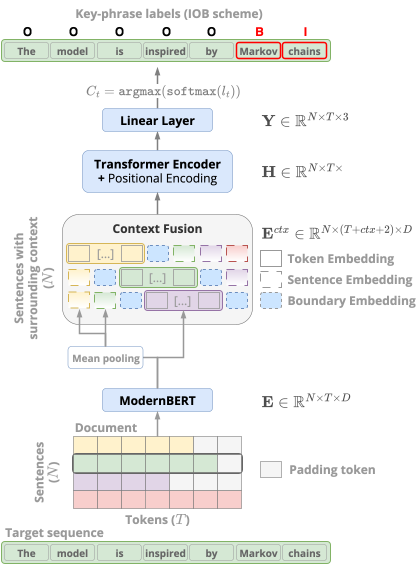

<h1 align="center">Fusing Sentence-Level and Document-Level Representations for Keyphrase Extraction</h1>

Transformer-based keyphrase extraction model fusing sentence and document-level representations of context.

<div align="center">



</div>


## Prerequisites

- Python 3.13+
- [uv](https://github.com/astral-sh/uv)
- [Apptainer/Singularity](https://apptainer.org/) (for container workflow)

## Installation

Clone the repository and install dependencies:

```bash
git clone <repository-url>
cd ctx-fusion
uv sync
```

## Container

For cluster environments, build a Singularity/Apptainer image:

1. Copy the example definition file and adjust proxy settings:
   ```bash
   cp container.def.example container.def
   ```

2. Build the image:
   ```bash
   apptainer build --force --fakeroot out/container.sif container.def
   ```

   Or via Makefile:
   ```bash
   make out/container.sif
   ```

## Configuration

1. Copy the example environment file:
   ```bash
   cp .env.example .env
   ```

2. Open `.env` and set the required variables. Key settings:

   ```
   USERNAME=your-username
   GPU_ID=0
   DATASET_FOLDER=/path/to/your/dataset/location
   EXPERIMENT_RUNS_FOLDER=/path/to/your/runs/location
   WANDB_API_KEY=
   WANDB_PROJECT=ctx-fusion
   SLURM_EMAIL=your-email@example.com
   ```

   See `.env.example` for the full list of variables including proxy and server hostname settings.

## Config Files

YAML configs in `configs/` control preprocessing, model architecture, datasets, and training hyperparameters:

- `preprocessing.yaml` — sentence segmentation, tokenization, keyword matching settings
- `models.yaml` — model architecture and encoder choices
- `datasets.yaml` — dataset-specific parameters
- `training.yaml` — learning rates, batch sizes, early stopping, evaluation settings, wandb config

## Scripts

### Preprocessing

Convert raw JSON datasets into Parquet files for training:

```bash
uv run scripts/prepare_data.py kp20k --splits train valid
```

Place raw `.json` files in `DATASET_FOLDER/<dataset_name>`. The script creates a `derived` subfolder with `train.parquet`, `valid.parquet`, etc.

### Training

Prerequisites: `prepare_data.py` must have been run first (it creates the parquet files in `{DATASET_FOLDER}/derived/` that this script reads from), and `DATASET_FOLDER` must be set in `.env`.

```bash
uv run scripts/train.py --dataset kp20k --device cuda
uv run scripts/train.py --from_config --wandb
```

### Evaluation

Prerequisites: `prepare_data.py` must have been run, `DATASET_FOLDER` set in `.env`, and a trained model checkpoint available.

```bash
uv run scripts/evaluate.py --checkpoint path/to/model.pt --dataset kp20k --split test
uv run scripts/evaluate.py --run-id <run-name> --checkpoint model_best.pt --dataset kp20k --split test --device cuda --n-documents 100 --per-doc
```

When `--run-id` is passed, the checkpoint is resolved relative to the runs root (`$EXPERIMENT_RUNS_FOLDER/<run-id>/`, or `$DATASET_FOLDER/runs/<run-id>/` if not set) and results are saved to `{run_dir}/evals/`.

## Makefile

The Makefile provides targets for container management, remote execution, and development workflow.

### Container

| Target | Description |
|---|---|
| `out/container.sif` | Build the Apptainer image |
| `shell` | Interactive shell inside the container with GPU access |

### Remote execution

Requires SSH + configured `.env`.

| Target | Description |
|---|---|
| `remote-train` | Start training on remote server (tmux or SLURM) |
| `remote-evaluate` | Run evaluation on remote server |
| `remote-preprocess-data` | Preprocess data on remote server |
| `attach-train` / `attach-evaluate` | Attach to running remote sessions |

### Data

| Target | Description |
|---|---|
| `sync-raw-data` | Sync raw JSON datasets to remote |
| `copy-run-folder RUN_NAME=...` | Copy a run folder from remote |
| `copy-run-model RUN_NAME=...` | Copy model checkpoints from remote |

### Development

| Target | Description |
|---|---|
| `sync` | Rsync project to remote server |

### SLURM management

| Target | Description |
|---|---|
| `slurm-setup` | Create project directories on cluster |
| `slurm-status` | Check job queue |
| `slurm-logs JOB_ID=...` | Tail SLURM job output |
| `slurm-cancel JOB_ID=...` | Cancel a job |

## SLURM Scripts

The `slurm/` directory contains batch scripts for cluster job submission. They run commands inside the Apptainer container with GPU access. Example: `slurm/train.sbatch` requests 1 GPU, 64G RAM, and runs `scripts/train.py` with args passed via the `TRAIN_ARGS` environment variable.

Submit via `make remote-train SERVER=kt-gpu4` or directly with `sbatch`.

## Reproducing Manuscript Artifacts

All tables and figures from the manuscript can be reproduced from run folders and bundled external data.

### Input Structure

```
experiment-data/
├── runs/
│   ├── young-haze-50/
│   │   ├── config.json
│   │   ├── metrics.json
│   │   └── evals/
│   │       └── eval_kp20k_test_*.json
│   ├── curious-smoke-52/
│   │   ├── config.json
│   │   └── evals/
│   │       └── eval_kp20k_test_*.json
│   ├── dutiful-oath-53/
│   │   ├── config.json
│   │   └── evals/
│   │       └── eval_kptimes_test_*.json
│   └── spring-bird-54/
│       ├── config.json
│       └── evals/
│           └── eval_inspec_test_*.json
├── kp20k/                          # optional
│   ├── kp20k_valid.json
│   └── derived/
│       └── valid.parquet
├── kptimes/
│   ├── kptimes_valid.json
│   └── derived/
│       └── valid.parquet
└── inspec/
    ├── inspec_valid.json
    └── derived/
        └── valid.parquet
```

Set in `.env`:

```
DATASET_FOLDER=/path/to/experiment-data/
```

The runs folder is resolved automatically as `$DATASET_FOLDER/runs`.

### Generated Artifacts

```
manuscript-artifacts/
├── metrics_table.png
├── metrics_table.tex
├── dataset_stats_table.tex          # only if dataset files present
├── precision_recall_table.tex
├── samples_table.tex
├── loss_overview.png
├── loss_overview.pdf
├── training_dynamics.png
├── loss_f1_overview.png
├── loss_f1_overview.pdf
├── modernbert_dynamics.png
├── keyphrase_stats.png
├── keyphrase_stats.pdf
├── ecdf_confidence_by_match_type.png
├── ecdf_confidence_by_match_type.pdf
├── stacked_bar_match_type_by_tier.png
└── stacked_bar_match_type_by_tier.pdf
```

### Run Mapping

| Semantic name | W&B run ID | Benchmark |
|---|---|---|
| `kp20k_training_set` | `young-haze-50` | kp20k |
| `kp20k_validation_set` | `curious-smoke-52` | kp20k |
| `kptimes_validation_set` | `dutiful-oath-53` | kptimes |
| `inspec_validation_set` | `spring-bird-54` | inspec |

See `src/ctx_fusion/data/runs.json` for the full mapping.

### Generate Artifacts

```bash
uv run reproduce-manuscript-artifacts
```

Or without installing:

```bash
uvx --from git+https://github.com/<owner>/<repo_url> reproduce-manuscript-artifacts
```

> [!NOTE]
> The `en_core_web_sm` spaCy model (~15MB) is downloaded automatically on first run.

Output is saved to `./manuscript-artifacts/` by default (override with `--output-dir`).

## Running Tests

Run the test suite using `pytest`:

```bash
uv run pytest
```
